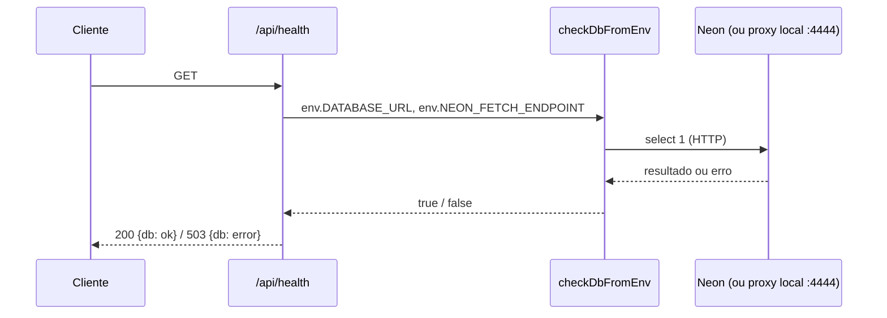
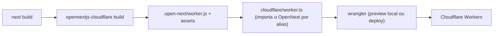
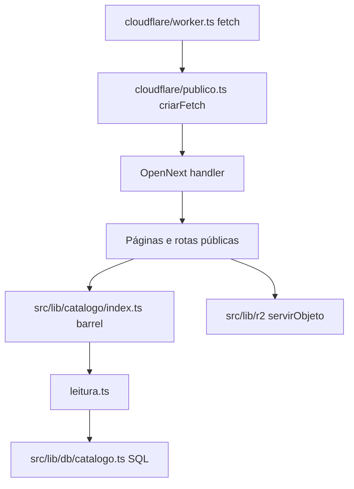

# Arquitetura

> Estado: **Fase 0 concluída + features 001 (autenticação), 002 (categorias)
> e 003 (produtos) implementadas; feature 004 (fotos) construída (SF1 a SF14) e em
> fechamento (SF15), ainda não em produção: servidor de fotos (`src/lib/r2/`,
> `src/lib/fotos/`, rota de exibição), pipeline da foto no aparelho, telas do cadastro e da
> tela Fotos, limpeza diária (worker próprio com `scheduled`) e sugestão por IA (servidor e
> tela do cadastro); feature 005 (catálogo público) construída, ramo FALLBACK, já em `main`
> (deploy de produção não verificado aqui); feature 006 (sacola e envio pelo WhatsApp)
> construída, pronta para o merge, ainda não em produção**. Este documento descreve apenas o que existe hoje
> no repositório. Para o que está planejado, ver `.specify/memory/constitution.md` e
> os ADRs em `specs/adr/`.

## Visão leiga

O Roseshop nasceu do template oficial do OpenNext para Cloudflare
(`create-next-app` + `@opennextjs/cloudflare`). A raiz do site agora é o **catálogo
público** (ver [F05-catalogo-publico.md](./features/F05-catalogo-publico.md)) e a **sacola**
com envio do pedido pelo WhatsApp (ver [F06-sacola-whatsapp.md](./features/F06-sacola-whatsapp.md)). As outras funcionalidades de produto são o
**login das administradoras** em `/painel` (ver
[F01-autenticacao.md](./features/F01-autenticacao.md)) e o **cadastro de
categorias** (ver [F02-categorias.md](./features/F02-categorias.md)) e o
**cadastro de produtos** (ver [F03-produtos.md](./features/F03-produtos.md))
no painel, com fotos de produto em andamento (feature 004). Uso real do banco: [database.md](./database.md).

O que já está de pé é a **esteira de build e deploy**: como o projeto, escrito
em Next.js, vira um Worker rodando na Cloudflare.

## Aprofundamento técnico

### Stack e versões (confirmado em `package.json`)

| Peça | Versão/pacote |
|---|---|
| Next.js | `16.3.8` (App Router, Turbopack) |
| React | `^19.1.7` |
| TypeScript | `^5.7.4` (modo `strict`, `target: es2024`) |
| Adaptador Cloudflare | `@opennextjs/cloudflare` `^1.20.3` |
| Wrangler (CLI Cloudflare) | `^4.147.0` |
| Tailwind CSS | `^4` (via `@tailwindcss/postcss`) |
| Lint | ESLint `^9`, flat config (`eslint-config-next`) |
| Testes | Vitest `^5.0.3` + Testing Library + jsdom (ver [operacao.md, "Testes"](./operacao.md#testes-vitest)) |

Banco: `drizzle-orm` `^0.45.3` e `@neondatabase/serverless` `^1.2.0` (runtime);
`drizzle-kit` `^0.31.11` e `pg` `^8.23.1` (dev, só migrations).

Autenticação (feature 001), dependências de runtime:

| Pacote | Versão | Observação |
|---|---|---|
| `next-auth` | `5.0.0-beta.32` (**exata**) | Auth.js v5, ainda beta (a tag `latest` do npm é a 4.x, descartada). Atualizar só em PR próprio, lendo o changelog e rodando `npm audit --omit=dev` (ADR-003, adendo; ADR-007). |
| `server-only` | `0.0.1` (**exata**) | Faz o build falhar se um módulo de servidor for importado no cliente. |
| `zod` | `^4.6.5` | Validação de e-mail da allowlist e de entradas da action de login. |

Fotos de produto (feature 004, em andamento), dependências de runtime e de build:

| Pacote | Versão | Observação |
|---|---|---|
| `aws4fetch` | `1.0.20` (**exata**) | Assinatura SigV4 (`AwsV4Signer`) da URL pré-assinada de envio ao R2. Sem dependências próprias (ADR-009 D1). |
| `react-easy-crop` | `6.2.3` (**exata**) | Recorte 1:1 com gesto de pinça no passo Fotos do cadastro (SF9); componente de cliente, sem binding nem variável de ambiente. |
| `wrangler` (dev) | `4.147.0` (**exata**, sem `^`) | O endpoint S3 local do R2 é experimental e depende da versão; ver [operacao.md, "wrangler fixado"](./operacao.md#wrangler-fixado-em-41470-devdependency). |

Não há no `package.json` SDK da OpenAI de propósito: a IA usa `fetch` direto à Responses API
(ADR-010; ver "Módulo de IA").

### Estrutura de código atual

```
src/app/
  layout.tsx    # layout raiz (fonts Geist via next/font/google, <html lang="pt-BR">, title "Roseshop")
  (public)/     # catálogo público (F05): page.tsx (/), p/[codigo]/ (detalhe, not-found), error.tsx, layout.tsx, _catalogo/ (componentes)
  (public)/sacola/page.tsx   # /sacola: casca da sacola (F06); componentes cliente em (public)/_sacola/
  api/catalogo/conferencia/route.ts   # POST: conferência pública da sacola (F06)
  fotos/[arquivo]/route.ts   # GET /fotos/<arquivo>: foto pública do catálogo, sem sessão (F05)
  api/catalogo/produtos/route.ts   # GET do bloco da lista ("Carregar mais") (F05)
  robots.ts     # /robots.txt sem Disallow (F05)
  globals.css   # estilos globais (Tailwind)
  api/health/route.ts   # GET /api/health (ver "Camada de banco")
  api/auth/[...nextauth]/route.ts   # handlers do Auth.js (GET, POST)
  api/interno/limpeza/route.ts      # POST da limpeza diária, só com CRON_SECRET (F04, SF12)
  painel/entrar/page.tsx            # tela de entrada (pública)
  painel/(protegido)/               # layout (moldura + "Sair"), page (saudação + links Produtos e Categorias), bfcache-reload
  painel/(protegido)/categorias/    # lista, nova/, [id]/renomear/, [id]/remover/ (F02)
  painel/(protegido)/produtos/      # lista, novo/ (cadastro em 2 passos), [id]/ (detalhe), [id]/editar/, [id]/remover/ (F03)
  painel/(protegido)/produtos/_fotos/  # fotos no cadastro e na tela Fotos: escolher, recortar, listar, enviar (F04, SF9/SF11)
  painel/(protegido)/produtos/[id]/fotos/  # tela Fotos do produto: adicionar, trocar, mover, remover (F04, SF11)
  painel/fotos/[arquivo]/route.ts   # GET /painel/fotos/<arquivo>: exibição da foto, fora do grupo (protegido) (F04)
src/components/ui/   # componentes base: button, campo-texto, area-texto, selecao, caixa-marcacao, mensagem-campo, aviso
src/lib/auth/   # Auth.js + allowlist + guards (ver "Autenticação e proteção do painel")
src/lib/categorias/   # módulo de domínio de categorias (barrel somente leitura, painel, actions)
src/lib/produtos/     # módulo de domínio de produtos (actions, sugestao, painel, validacao, preco, codigo, erros, mensagens)
src/lib/r2/   # R2: config, chaves, assinatura, bucket e verificação do arquivo (ver "Módulo R2")
src/lib/catalogo/   # catálogo público (F05): barrel server-only, leitura, config, cursor, slug, exibicao, restauracao, falha/registro, prazos
src/lib/sacola/   # sacola (F06): regras puras no navegador (observacao, sacola, total, mensagem, conferencia, armazenamento, textos); sem server-only (ver "Sacola e conferência")
src/lib/ai/   # IA (SF13): config, sugestao (fetch à OpenAI), barrel server-only (ver "Módulo de IA")
src/lib/fotos/   # fotos: actions de envio (pedirEnvio, confirmarEnvio), tipos, mensagens, erros, validacao, exibicao, limpeza
cloudflare/   # worker próprio (worker.ts: fetch do OpenNext + scheduled), publico.ts (casca das rotas públicas, F05) e open-next-worker.d.ts
scripts/      # require-ci.mjs, smoke-health.sh e seed-catalogo-local.ts (+ seed-catalogo-local/): seed de teste do catálogo (npm run seed:*)
src/lib/fotos/aparelho/   # pipeline da foto só de navegador (SF8): tipo, recorte 1:1, WebP/JPEG até 1 MiB
infra/r2/     # CORS dos buckets, versionado (cors.dev.json, cors.production.json)
src/lib/db/
  client.ts     # createDb: Drizzle + driver HTTP do Neon
  health.ts     # checkDb: select 1
  schema.ts     # schema Drizzle (categorias, produtos, produto_fotos, fotos_envio, ia_uso)
  categorias.ts, produtos.ts, fotos.ts, ia-uso.ts, catalogo.ts # camadas SQL (catalogo.ts: leituras públicas, F05); contexto.ts, locks.ts, erros-pg.ts
  migrations/   # 0000 (função categoria_chave + categorias + seed), 0001 (produtos, produto_fotos), 0002 (fotos_envio, ia_uso, colunas de fotos) e meta/
  *.test.ts / *.int.test.ts   # testes unitário e de integração
src/test/       # conformance/ (testes de guard e de acesso) e db/ (fixtures de integração, medição de desempenho)
drizzle.config.ts   # config do drizzle-kit (migrations em src/lib/db/migrations)
vitest.config.mts, vitest.int.config.mts, vitest.probe.config.mts, vitest.perf.config.mts, vitest.ia.config.mts   # unitário, integração, probe do CI, medição local, medição manual da IA
```

Rotas: `/` (catálogo público), `/p/[codigo]`, `/fotos/[arquivo]`, `/robots.txt`,
`GET /api/catalogo/produtos`, `/sacola` e `POST /api/catalogo/conferencia` (todas públicas, ver "Catálogo público" e "Sacola e conferência"), `/api/health`, `/painel/entrar`, `/painel`, `/api/auth/*` e as
quatro de `/painel/categorias` (lista, `nova`, `[id]/renomear`, `[id]/remover`)
as cinco de `/painel/produtos` (lista, `novo`, `[id]`, `[id]/editar`, `[id]/remover`)
e `GET /painel/fotos/[arquivo]` (exibição de foto, guardada por sessão; ver
[F04](./features/F04-fotos.md)), além de `POST /api/interno/limpeza` (interna, chamada só pelo
cron, protegida por `CRON_SECRET`, 404 para qualquer outro caso).
**Nenhum middleware** (de propósito; ver a seção seguinte).

### Autenticação e proteção do painel

**Visão leiga**: só as administradoras entram em `/painel`, com a conta Google,
e só se o e-mail estiver na lista `ADMIN_EMAILS`. Como o projeto não usa
middleware, cada página e cada ação confere sozinha quem está pedindo, e um teste
automático garante que ninguém esqueça essa conferência.

**Aprofundamento técnico** (zona protegida: `src/lib/auth/`):

- Auth.js v5 com Google, sessão **JWT em cookie, sem adapter e sem tabelas**.
  Configuração criada **por request** (`NextAuth(() => createAuthConfig())`),
  porque os secrets do Worker só existem em `process.env` durante o request.
- **Sem `middleware.ts`/`proxy.ts`**: o `proxy.ts` do Next 16 roda só em Node e
  o OpenNext o trata como experimental (ADR-003, adendo). Em vez disso:
  `getAdminSession` no layout (nunca redireciona), `requireAdminPage` em cada
  página, `requireAdminAction` em cada action e route handler. O teste
  `src/test/conformance/painel-guard.test.ts` nega por padrão e mantém a lista
  de exceções públicas por função.
- `trustHost: true`, sem `AUTH_URL` fixo (host da requisição; justificativa no
  adendo do ADR-003). Respostas de `/painel/:path*` saem com
  `Cache-Control: private, no-store` (`next.config.ts`).
- A allowlist é conferida no callback de login **e** a cada acesso
  (`getAdminSession`), então remover um e-mail bloqueia no próximo request.

Rotas, módulos, fluxo e pegadinhas em
[features/F01-autenticacao.md](./features/F01-autenticacao.md). Variáveis e
procedimento de emergência em [operacao.md](./operacao.md#administradoras-e-emergência-de-acesso).

### Camada de banco e health check

**Visão leiga**: o app já sabe "conversar" com o banco, mas ainda não guarda
nada. A única prova disso é o endereço `/api/health`, que responde se o banco
está de pé (útil para monitoramento e para checar o ambiente).

**Aprofundamento técnico** (zona protegida: `src/lib/db/`):

| Rota / função | Arquivo | O que faz |
|---|---|---|
| `GET /api/health` | `src/app/api/health/route.ts` | Lê `env` via `getCloudflareContext({ async: true })` e chama `checkDbFromEnv`. Responde `{db: "ok"}` com 200 ou `{db: "error"}` com 503, sempre com `Cache-Control: no-store`; `dynamic = "force-dynamic"`. |
| `createDb(env)` | `src/lib/db/client.ts` | Exige `DATABASE_URL` (lança erro se vazia). Se `NEON_FETCH_ENDPOINT` existir, seta `neonConfig.fetchEndpoint` (proxy local); senão usa o endpoint padrão do Neon. Retorna `drizzle({ client: neon(url), schema })` (`drizzle-orm/neon-http`). |
| `checkDbFromEnv(env)` | `src/lib/db/health.ts` | Chama `createDb` dentro de try/catch: configuração ausente ou inválida registra `[health] configuração do banco ausente ou inválida` e devolve `false` (503), **sem lançar**. Senão delega a `checkDb`. |
| `checkDb(db)` | `src/lib/db/health.ts` | Executa `select 1`; em falha registra só o `error.name` (a mensagem do driver pode conter host/usuário) e devolve `false`. |



Migrations: `drizzle-kit` (`drizzle.config.ts`) usa o driver `pg` por **TCP
direto** (não o proxy HTTP), conforme ADR-002, e escreve em
`src/lib/db/migrations/` (hoje só a `0000`, da feature 002; schema e tabelas em
[database.md](./database.md)). Validado no workerd: `npm run preview` ->
`/api/health` 200 `{db: ok}`.

**Sem transação interativa (ADR-008)**: o driver `neon-http` não suporta
`db.transaction()`. O que precisa de atomicidade usa `db.batch([...])` (uma
transação `READ COMMITTED`) com lock advisory (`pg_advisory_xact_lock`), cujas
chaves ficam em `src/lib/db/locks.ts`; invariantes que o banco consegue
expressar vão para constraints, colunas geradas e FKs. Nenhum código pode
assumir `db.transaction()`. Exemplo real: a remoção de categorias
([F02](./features/F02-categorias.md#fluxo-de-remoção-o-ponto-mais-delicado)).

**Acesso por contexto**: `src/lib/db/contexto.ts` (`dbDoContexto`) é a porta
que obtém o `db` a partir das bindings do Worker (`getCloudflareContext`)
para os módulos de categorias e produtos; `/api/health` continua montando o `db` por conta
própria.

**Connection string única (decisão N1 da feature 002)**: app (Worker dev), migration
e probe de CI usam o **mesmo** `DATABASE_URL` direto do Neon dev, sem pooler. O
`DATABASE_URL` do app vive como secret na Cloudflare; o do CI, como secret do
GitHub Environment `dev`; ambos com o mesmo valor (ver
[operacao.md, "CI"](./operacao.md#ci)). Se o app passar a usar a string com pooler,
o probe do `db.batch` precisa ser repetido antes de chegar à produção (ADR-008).

Pegadinhas e dívidas:

- `cloudflare-env.d.ts` (gerado pelo `cf-typegen` a partir do `.dev.vars`
  local) tipa `NEON_FETCH_ENDPOINT` como `string` obrigatória, mas ela não
  existe em dev online e produção; `DbEnv` a trata como opcional. Cuidado ao
  confiar no tipo gerado.
- `createDb` muda `neonConfig` global (estado de módulo) a cada chamada
  quando `NEON_FETCH_ENDPOINT` está definida.

### Build e deploy (OpenNext + Wrangler)

O fluxo de build é o padrão do adaptador `@opennextjs/cloudflare`:



- **Worker próprio** (SF12): o `main` do `wrangler.jsonc` é `cloudflare/worker.ts`, não mais
  `.open-next/worker.js`. Ele reexporta o `fetch` do OpenNext e acrescenta o `scheduled` da
  limpeza diária (ver [F04](./features/F04-fotos.md#limpeza-diária-sf12)). O OpenNext é
  importado pelo nome `open-next-worker`, ligado a `./.open-next/worker.js` por um `alias`
  no **nível de cima** do `wrangler.jsonc` (o wrangler só lê `alias` ali) e declarado em
  `cloudflare/open-next-worker.d.ts`. `.open-next` está no `exclude` do `tsconfig.json`, para o
  `typecheck` dar o mesmo resultado com e sem build local
  (`src/test/conformance/worker-typecheck.test.ts`).
- `triggers.crons` (`["0 6 * * *"]`, 03:00 de Brasília) é declarado nos **três** ambientes:
  deploy sem a chave não remove um cron já publicado.
- `next.config.ts` chama `initOpenNextCloudflareForDev()` — isso é o que permite
  usar `getCloudflareContext()` (acesso a bindings) rodando `next dev`, mesmo
  esse não sendo o runtime real de produção.
- `open-next.config.ts` usa `defineCloudflareConfig()` sem overrides. Há um
  comentário indicando que o cache incremental via R2
  (`r2-incremental-cache`) está disponível mas **desativado** — ninguém
  habilitou ainda.
- `wrangler.jsonc` tem **três ambientes** (detalhes e comandos em
  [operacao.md, "Deploy"](./operacao.md#deploy)): o nível de cima é o **local**
  (worker `roseshop-local`), `env.dev` é `roseshop-dev` e `env.production` é
  `roseshop`. Bindings são redeclarados por env, com o mesmo nome; `ASSETS` é
  herdado. O nível de cima declara:
  - `assets` — binding `ASSETS`, servindo `.open-next/assets` (estáticos).
  - `images` — binding `IMAGES`, para otimização de imagem do Next via Cloudflare
    Images (habilitado, mas nada no app ainda usa `next/image` além do boilerplate).
  - `services` — binding `WORKER_SELF_REFERENCE`, auto-referência do worker a
    si mesmo (`roseshop-local` no nível de cima; cada env aponta para o seu), usada pelo OpenNext para caching (ver
    [docs do OpenNext](https://opennext.js.org/cloudflare/caching)).
  - `observability.enabled: true` e `upload_source_maps: true`.
  - `r2_buckets` — binding `PRODUCT_IMAGES` (local `roseshop-local`, simulado;
    dev `roseshop-dev`; produção `roseshop-prod`). Usado por
    `src/lib/r2/bucket.ts` (chamado pelas actions de `src/lib/fotos/` e pela rota de exibição). O item local
    traz `local_dev.experimental_s3_credentials` com credenciais **falsas e fixas**
    (não são segredo), que ligam o endpoint S3 do `preview`.
  - `vars.R2_S3_ENDPOINT` — endpoint S3 do bucket do ambiente (local
    `http://localhost:8787/cdn-cgi/local/r2/s3/roseshop-local`; dev e produção
    `https://<id da conta>.r2.cloudflarestorage.com/<bucket>`). `vars` não são
    herdadas: cada env redeclara.
  - `compatibility_date: "2026-10-01"` e flag `global_fetch_strictly_public`.
- `public/_headers` aplica cache imutável de 1 ano para `/_next/static/*`
  (arquivo lido pelo asset handler do Workers, não pelo Next).

Não há binding de banco (Neon/Hyperdrive) nem de IA em `wrangler.jsonc` (o banco é acessado
por `DATABASE_URL`, secret/var, via HTTP; a IA, por `OPENAI_API_KEY`, secret, lida de
`process.env`).

### Ambientes decididos nos ADRs 002 e 006 (implementados)

A constitution (princípio VIII) e o ADR-006 (revisado) definem **três camadas
isoladas**. Hoje existem no repositório o `preview`, os três ambientes no
`wrangler.jsonc` (workers dev e produção publicados) e a stack Docker local de banco (`docker-compose.yml`, detalhada em
[operacao.md, "Banco local"](./operacao.md#banco-local-docker)). A stack
(Postgres 18 + proxy HTTP do Neon, scripts `npm run db:*`) já é consumida pelo app:
o Drizzle está configurado (`src/lib/db/`, `drizzle.config.ts`) e a conexão é
validada por `/api/health` (`src/app/api/health/route.ts`) e pelo teste de
integração `src/lib/db/client.int.test.ts` (`npm run test:int`, exige `db:up`).
O schema tem `categorias` (migration `0000`), `produtos` e `produto_fotos`
(`0001`), `fotos_envio` e `ia_uso` (`0002`, feature 004 em andamento; só
`fotos_envio`, `produto_fotos` e `ia_uso` já têm código que as use; ver
[database.md](./database.md)).

| Recurso | Local | Dev online | Produção |
|---|---|---|---|
| Runtime | `npm run preview` (workerd) | Worker `roseshop-dev` | Worker `roseshop` |
| Banco | Postgres em Docker (ADR-002) | Neon, branch `dev` | Neon, branch `production` |
| Imagens | R2 simulado pelo wrangler (`.wrangler/state/`) | R2 `roseshop-dev` | R2 `roseshop-prod` |
| OpenAI | chave dev, limite baixo | chave dev, limite baixo | chave prod |
| Segredos | `.dev.vars` | `wrangler secret --env dev` | `wrangler secret --env production` |
| Login | Google, callback `localhost` | Google, callback dev | Google, callback produção |

Pontos-chave:

- **Banco (ADR-002)**: Postgres em todas as camadas, com um único driver,
  `@neondatabase/serverless` (HTTP). No local, o Postgres do Docker é exposto
  por um proxy HTTP compatível com o protocolo do Neon no mesmo
  `docker-compose` (implementado: Postgres 18 + proxy em `127.0.0.1:4444`); o
  endpoint vem de variável de ambiente (`NEON_FETCH_ENDPOINT`, só no local),
  sem ramificação no código. Migrations (Drizzle + `drizzle-kit`) são SQL versionado, aplicado
  local → dev → produção, usando conexão direta (não o proxy).
- **Entrega (ADR-006)**: PR → CI (lint, typecheck, testes, integração com
  `db:migrate` no Postgres do job) → migration no Neon `dev` → probe do
  `db.batch` e da FK de produtos no Neon `dev` → deploy em `roseshop-dev`; merge em `main` (humano) → migration no
  Neon `production` → deploy em `roseshop`. Segredos de deploy em GitHub
  Environments; segredos de runtime só na Cloudflare. Implementado em
  `.github/workflows/` (ver [operacao.md, "CI"](./operacao.md#ci)).
- **Regras**: a máquina local nunca acessa dev online nem produção; bindings
  do wrangler são declarados por environment (não herdados) e
  `WORKER_SELF_REFERENCE` aponta para o worker do próprio ambiente; mudança
  destrutiva de schema segue expand/contract.
- **Cota compartilhada**: os limites do free tier da Cloudflare são da conta,
  então dev e produção disputam a mesma cota; teste de carga roda só na stack
  Docker local.

### Alinhamento com ADR-006

Os blocos `env` do `wrangler.jsonc` (`dev` e `production`) existem (commit
`fffa3fe`), o `docker-compose.yml` é consistente com o ADR-002 e o CI
(`.github/workflows/`) implementa o fluxo do ADR-006 em `main`. O worker
`roseshop` (produção) está no ar desde o primeiro deploy pelo CI (merge do PR
#9, relato do mantenedor; `/api/health` = 200). O branch `main` é protegido
(informação do mantenedor, ver [operacao.md](./operacao.md#ci)).
`scripts/require-ci.mjs` bloqueia o deploy manual de produção. Detalhes em
[operacao.md, "CI"](./operacao.md#ci).

**Risco resolvido**: a flag `global_fetch_strictly_public` em
`wrangler.jsonc` **não** bloqueia o `fetch` do worker ao proxy local
(`localhost:4444`), validado no `preview` (ver
[operacao.md, "Banco local"](./operacao.md#banco-local-docker)).

### Processo de especificação (Spec Kit)

O repositório adotou o Spec Kit (v1.0.6, integração `claude`):

| Caminho | Papel |
|---|---|
| `.specify/memory/constitution.md` | Constitution v1.0.0 (princípios I a VIII); fonte das regras não negociáveis. Substitui o antigo `specs/00-constitution.md`, que não existe mais. |
| `.specify/templates/` | Templates de spec, plan, tasks, checklist e constitution. |
| `.specify/scripts/bash/` | Scripts usados pelas skills (criar feature, pré-requisitos, setup de plan/tasks). |
| `.specify/workflows/`, `.specify/*.json` | Workflow e estado/manifestos da integração. |
| `.claude/skills/speckit-*` | Skills `/speckit-specify`, `clarify`, `plan`, `tasks`, `analyze`, `implement`, `converge`, `checklist`, `constitution`, `taskstoissues`. |
| `specs/NNN-nome/` | Uma pasta por feature (`spec.md`, `plan.md`, `tasks.md`, entre outros). Hoje existem `001-auth-admins/` e `002-categorias/`. |
| `specs/adr/` | ADRs: `001`, `002`, `003`, `004`, `006`, `007` e `008` (integridade de dados com neon-http; ver a pasta). |

O `plan.md` de cada feature passa pelo Constitution Check. A ordem de uso está
no `CLAUDE.md`, seção "Spec Kit". Mapeamento da numeração antiga da
constitution para a nova: seção 4 = III (Segurança), 5 = IV, 6 = V, 7 = VI,
8 = VII (Ambiente e plataforma), 9 = VIII (Ambientes).

### Dívidas técnicas

- **Sem formatador de código** (decisão do humano, 2026-10-03): o repositório
  mistura tabs (`src/app/layout.tsx`, `src/app/page.tsx`,
  `src/components/ui/button.tsx`, `src/app/painel/(protegido)/page.tsx`,
  `next.config.ts`) e 2 espaços (`src/lib/`, demais arquivos do painel), sem
  formatador configurado. Adotar um em PR próprio, depois da feature 001.
- **Definições dos agentes** (`.claude/agents/`) a ajustar (decisão do humano,
  2026-10-04, após violações de processo na feature 001): nenhum agente executa
  pacote via `npx` que não seja dependência do projeto; nenhum agente executa
  comando fora do briefing; as verificações do `junior` nunca são finais (o
  tech-lead as reexecuta antes de reportar ao humano). Ver
  `specs/001-auth-admins/tasks.md`, "Dívidas registradas".
- **Cobertura do guard depende do teste de conformidade**: sem filtro central,
  um novo padrão de arquivo que o teste não conheça fica desprotegido sem
  alerta; estenda o teste ao introduzi-lo (ADR-003, adendo).
- **Comentário defasado em `.github/workflows/pull-request.yml`** (linha ~50):
  ainda diz que o probe roda "só `batch-transacao.int.test.ts`, sem tabelas", mas
  `vitest.probe.config.mts` agora inclui também `fk-produtos.int.test.ts`
  (escreve e apaga linhas marcadas). Config fora do escopo do doc-sync; ajustar
  em PR próprio.
- **Fotos servidas por `` simples** (SF11): detalhe, lista e tela Fotos apontam para
  `/painel/fotos/<arquivo>` (rota com sessão, `Cache-Control` privado e imutável); não há
  otimização de imagem do Next (`no-img-element` desligado com comentário).
- **Objetos órfãos dependem do cron** (SF12): recusa de confirmação e remoção de produto
  apagam objetos do R2 em melhor esforço; a limpeza diária recolhe o resto. A prova do cron
  no `roseshop-dev` foi capturada em 2026-10-15 (T118b; ver
  [operacao.md](./operacao.md#limite-de-cpu-do-plano-gratuito-do-workers)).
- **Durable Objects do OpenNext não reexportados**: `.open-next/worker.js` também exporta
  classes de DO (fila e cache de tags); hoje não há `durable_objects` no `wrangler.jsonc`.
  Se o cache com DO for ligado, reexportar as classes em `cloudflare/worker.ts`.
- **`next-auth` em beta** (`5.0.0-beta.32`, versão exata): atualização manual e
  deliberada.
- **Catálogo sem cache de servidor** (F05, ADR-011): toda visita a `/` e `/p/*` renderiza e
  consulta o Neon; o cache é só o do navegador. É o que cabe em `*.workers.dev`; se um
  domínio próprio entrar, reavaliar cache de borda.
- **Fotos do catálogo e do painel por rotas diferentes**: `/fotos/[arquivo]` (pública, confere
  `produto_fotos`) e `/painel/fotos/[arquivo]` (sessão, aceita também envio confirmado).

### Módulo R2 (feature 004, SF2, SF3 e SF6)

> Estado: o módulo já tem chamadores desde a SF6 (actions de `src/lib/fotos/`, remoção
> de produto e a rota de exibição). UI de fotos existe desde a SF11 e a limpeza diária desde a SF12; a IA (SF13) tem seu módulo próprio, abaixo.

**Visão leiga**: a foto do produto não passa pelo servidor do site. A administradora
pede uma "autorização de envio" (uma URL temporária, válida por 5 minutos), o aparelho
manda o arquivo direto ao armazenamento (R2) e o servidor depois confere o que chegou.
Esta base entrega as peças: conferir o arquivo, gerar a autorização e ler/apagar objetos.

**Aprofundamento técnico** (zona protegida: `src/lib/r2/`; contrato em
`specs/004-fotos-produto/contracts/fotos.md`, decisões no ADR-009):

| Arquivo | Papel |
|---|---|
| `src/lib/r2/index.ts` | Barrel `server-only`: única porta de entrada para actions e rotas; reexporta `verificacao/`. |
| `src/lib/r2/verificacao/` | SF2. Verificação por lista de permitidos de JPEG e WebP (`verificarImagem`): lê o arquivo inteiro sem decodificar, lado entre `LADO_MINIMO` (400) e `LADO_MAXIMO` (1200), recusa animação e metadados fora da lista. Modo `registro` relaxa só o metadado (`modo.ts`). |
| `src/lib/r2/config.ts` | `configR2()`: valida com Zod `R2_S3_ENDPOINT` (https, exceto `localhost`/`127.0.0.1`; sem `/` final), `R2_ACCESS_KEY_ID` e `R2_SECRET_ACCESS_KEY` lidos de `process.env` a cada uso. O erro cita só os nomes. |
| `src/lib/r2/chaves.ts` | Chave do objeto `fotos/<uuid v4>.<webp\|jpg>`; `ARQUIVO_VALIDO` é a mesma regex da rota de exibição e do CHECK de `produto_fotos`. |
| `src/lib/r2/assinatura.ts` | `assinarEnvio({ chave, formato, tamanho })`: URL pré-assinada de PUT (SigV4, `AwsV4Signer`), expira em 300 s, com `content-length`, `content-type` e `if-none-match: *` assinados; tamanho de 1 a 1 MB. |
| `src/lib/r2/bucket.ts` | Acesso pelo binding `PRODUCT_IMAGES`: `lerObjeto` (tamanho vem dos metadados), `apagarObjetos` (lotes de 1000; chave inexistente não é erro) e `listarObjetos` (paginado por cursor); SF6: `servirObjeto(chave, ifNoneMatch)`, que lê com `onlyIf` e devolve `{ etag, tamanho, corpo }` (`corpo: null` quando o ETag casa, base do 304). |

```mermaid
sequenceDiagram
  participant C as Chamador (src/lib/fotos/actions.ts)
  participant M as src/lib/r2
  participant R as R2 (endpoint S3)
  C->>M: assinarEnvio(chave, formato, tamanho)
  M-->>C: URL assinada (5 min) + headers
  C->>R: PUT assinado pelo aparelho
  R-->>C: 200 (outro tamanho: 403; segundo PUT: 412)
  C->>M: lerObjeto(chave) + verificarImagem
```

O fluxo completo (actions, rota de exibição, cadastro) está em
[F04-fotos.md](./features/F04-fotos.md). Detalhes de operação (segredos, CORS, endpoint local) em
[operacao.md, "R2: segredos, endpoint e CORS"](./operacao.md#r2-segredos-endpoint-e-cors).

Pegadinhas:

- **Tamanho e `if-none-match` são impostos pelo R2**: PUT com tamanho diferente do
  assinado recebe 403; segundo PUT na mesma chave recebe 412 (prova local T039 em
  `specs/004-fotos-produto/research.md`, seção 3).
- **`AwsV4Signer` direto, não `AwsClient.sign`**: o signer só calcula a URL; montar um
  `Request` com `content-length` poderia ser recusado pelo workerd. `X-Amz-Expires` é
  posto **antes** de assinar (senão a lib usa 24 h).
- **Endpoint S3 local é experimental** e por isso o `wrangler` está fixado; valide
  envio no `preview`, nunca no `dev` (o binding só existe no worker).
- **Fronteira do barrel**: só `@/lib/r2` (com `server-only`) pode ser importado fora de
  `src/lib/r2/`; a regra `proibirSubmoduloR2` do `eslint.config.mjs` e o teste
  `src/test/conformance/fotos-acesso.test.ts` a impõem.
- **Credenciais no `process.env`**: como os demais secrets, só existem durante o
  request do Worker; não leia no escopo do módulo.

### Pipeline da foto no aparelho (feature 004, SF8)

Único código de `src/lib/fotos/` que roda **no navegador**: `src/lib/fotos/aparelho/`. Fica
entre a escolha do arquivo e `pedirEnvio`: detecta o tipo pelos bytes, abre a imagem com a
orientação da câmera, recorta 1:1 (400 a 1200 px, nunca amplia) e recodifica em WebP ou JPEG
até caber em 1 MiB, o que descarta os metadados. Não importa `server-only`, `@/lib/r2`,
`@/lib/db`, auth nem `next`; `src/lib/fotos/aparelho/fronteira.test.ts` garante isso. Não há
binding nem variável de ambiente envolvidos. O servidor não confia nele: `confirmarEnvio`
reverifica o arquivo. Detalhes, motivos e pegadinhas em
[F04](./features/F04-fotos.md#pipeline-da-foto-no-aparelho-srclibfotosaparelho-sf8).

Diferença `next dev` × navegadores: o suporte a WebP em canvas varia (Safari antigo devolve
PNG), e por isso `suportaWebp` e a conferência do `blob.type` existem. A prova em aparelho
real foi feita no Chrome Android (SF10); Safari iOS é risco aceito (ver a F04). `prepararFoto` deixa rastro de falha em dev e
em produção (`console.warn("fotos.aparelho.nao_enviada", { erro: e.name })`, só o `name`).

### Telas do cadastro com fotos (feature 004, SF9)

`/painel/produtos/novo` renderiza o client component `cadastro-produto.tsx` (passos
Fotos → Dados). O envio vai do navegador direto ao R2: `prepararFoto` → `pedirEnvio` (Server
Action) → `PUT` na URL assinada (tempo limite de 60 s) → `confirmarEnvio`; o `criarProduto`
recebe só os `envioIds`. Nenhum binding ou variável nova. Em `next dev` o `PUT` não funciona
sem o endpoint S3 do R2, que só existe no worker: valide no `preview`. Detalhes em
[F04](./features/F04-fotos.md#telas-do-cadastro-painelprodutosnovo-sf9).

### Módulo de IA (feature 004, SF13)

> Estado: servidor (SF13) e tela do cadastro (SF14, ver F04). Zona protegida (tech-lead).

Dá à administradora uma sugestão de nome, categoria e descrição a partir das fotos já
enviadas; nada é gravado, ela só recebe o texto para conferir. Fluxo e regras na
[F04](./features/F04-fotos.md#sugestão-por-ia-sf13).

| Arquivo | Papel |
|---|---|
| `src/lib/ai/config.ts` | Constantes: `MODELO` (`gpt-6-luna`) e `ESFORCO` (`none`), **provisórios até a medição da SF13 (T133)**; `TEMPO_LIMITE_MS` 20 000, `MAX_SAIDA` 800, `LIMITE_POR_PESSOA` 30 e `LIMITE_TOTAL` 100 por dia de Brasília. |
| `src/lib/ai/sugestao.ts` | `pedirSugestao`: `fetch` direto à Responses API (`https://api.openai.com/v1/responses`), `store: false`, saída `json_schema` estrita, imagens em base64 com `detail: "low"`, aborto em 20 s; revalida a forma da resposta (Zod `.strict()`, `categoria_id` só da lista enviada). Log `ia.sugestao` só com modelo, status HTTP, duração, contadores numéricos de `usage` e o motivo da falha; nunca chave, imagem, prompt nem texto devolvido. |
| `src/lib/ai/index.ts` | Barrel `server-only`: `pedirSugestao`, tipos e os dois limites. |
| `src/lib/ai/medicao-relatorio.ts` | Tabela Markdown da medição manual (T132; `ia-medicao/resultado.md`, fora do git). Puro e sem `server-only`; usado só por `medicao.ia.test.ts`. |

- **Fronteira**: `api.openai.com` e `OPENAI_API_KEY` só aparecem em `src/lib/ai/`;
  `src/test/conformance/ia-acesso.test.ts` (AST, nega por padrão) também restringe quem
  importa `@/lib/ai`, `@/lib/db/ia-uso` e `@/lib/produtos/sugestao`.
- **Contador**: `consumirSugestao` em `src/lib/db/ia-uso.ts` (um `db.batch` sob
  `LOCK_IA_USO` = 4002, dia de Brasília; ver [database.md](./database.md#tabela-ia_uso)).
- **Teto de gasto no provedor**: aplicado no projeto OpenAI dev em 2026-10-12 (T014b, ADR-010) e no projeto de produção (separado, T148, 2026-10-14).
- **Modelo em produção**: `gpt-6-luna` com esforço `none`, provisórios (ADR-010 emendado em 2026-10-14); T132/T133 são pendência de entrega.
- **Medição manual**: `npm run test:ia` (ver [operacao.md](./operacao.md#testes-vitest)).
- **Risco aceito (CPU)**: `sugerirProduto` mediu 21 ms de CPU no dev, acima dos 10 ms do
  Workers Free; ver [operacao.md](./operacao.md#limite-de-cpu-do-plano-gratuito-do-workers).
  Em `next dev` o Node não mostra o limite de CPU do Worker: medir no dev online.

### Catálogo público (feature 005)

> Estado: construído no **ramo FALLBACK** da spec (páginas dinâmicas), já em `main`
> (commits da 005 no histórico de `main`). Fluxo, arquivos e pegadinhas na [F05](./features/F05-catalogo-publico.md).

Em `*.workers.dev` não existe cache de borda da Cloudflare, e a spec exige que mudanças do
painel apareçam em até 1 minuto. O spike da SF0 reprovou o ISR do OpenNext, e o
[ADR-011](../specs/adr/011-cache-catalogo-workers-dev.md) fixou: **páginas dinâmicas, sem ISR,
sem bucket de cache, sem Durable Object e sem permissão nova no token do CI**.
`open-next.config.ts` e `next.config.ts` não mudaram por causa disso.

| Rota | Quem atende | Resposta pública |
|---|---|---|
| `/` | `src/app/(public)/page.tsx` (`force-dynamic`) | 200 com `Cache-Control: public, max-age=60` |
| `/p/[codigo]` | `src/app/(public)/p/[codigo]/page.tsx` (`force-dynamic`) | 200, 308 (código fora do canônico) ou 404, todos com `max-age=60` |
| `/fotos/[arquivo]` | `src/app/fotos/[arquivo]/route.ts` | 200/304/404 com `max-age=60`, `ETag`; 503 `no-store` |
| `GET /api/catalogo/produtos` | `src/app/api/catalogo/produtos/route.ts` | `max-age=20`; 400 e 503 `{}` `no-store` |

Quem faz o quê (as camadas):



- **`cloudflare/publico.ts`** envolve o `fetch` do OpenNext só para `/`, `/p/*`, `/fotos/*` e
  `/api/catalogo/*` (painel, `/api/auth`, `/api/interno`, `/api/health` e assets passam
  intactos, e métodos que não leem também). Para `/p/<x>`: código numérico válido e não
  canônico recebe **308** para `/p/<4 dígitos>` (preservando a query); lixo, zero ou mais de 9
  dígitos é reescrito para `/p/0` (404 fixo, sem consultar o banco). Depois do Next: define
  `X-Robots-Tag: noindex, nofollow` em todas as respostas dessas rotas e `Cache-Control: public,
  max-age=60` nas páginas com 200, 308 ou 404.
- **503 das páginas públicas**: todo 500 de `/` e `/p/*` (ou exceção do handler) vira **503**
  `Service Unavailable` com `Cache-Control: no-store` e `Retry-After: 30`. O evento registrado é
  `catalogo.banco_indisponivel` se `leitura.ts` marcou a causa `banco`, senão
  `catalogo.erro_inesperado`. A marca viaja num `ctx` próprio do pedido (`roseshop`), que o OpenNext
  devolve em `getCloudflareContext().ctx`; fora do worker (teste, `next dev`) a marca não existe.
  Não há "versão anterior" para servir (só existiria com ISR).
- **Registro** (`src/lib/catalogo/falha.ts`): `console.error` JSON com evento, rota e causa de
  listas fechadas; nunca a mensagem da exceção, a chave do objeto, a URL com query nem valores
  de configuração. Eventos: `catalogo.banco_indisponivel`, `catalogo.erro_inesperado`,
  `catalogo.fotos_falha`, `catalogo.whatsapp_invalido`, `catalogo.site_url_invalida`.
- **`X-Robots-Tag`** também sai do `metadata.robots` do layout público e do `/robots.txt` sem
  `Disallow` (para o buscador conseguir ler o `noindex`).
- **Bucket privado**: as fotos só saem pela rota `/fotos/[arquivo]`, via binding
  (`servirObjeto`), nunca por URL pública do R2; o
  `src/test/conformance/fotos-bucket-privado.test.ts` confere só o que está no repositório (CORS
  de `infra/r2/` e `wrangler.jsonc`); acesso público `r2.dev` e domínio do bucket são conferência
  manual (quickstart §1, item 5).
- **Fronteira de módulo**: páginas e rotas importam só o barrel `@/lib/catalogo` (mais os
  módulos puros `exibicao`, `prazos`, `restauracao`); regra de lint em `eslint.config.mjs`.
  Conformidade: `catalogo-acesso.test.ts` (nega por padrão: a rota pública de fotos existe e
  nenhuma rota fora de `painel/`, `api/auth/` e `api/interno/` usa sessão),
  `fotos-acesso.test.ts` (`@/lib/r2` no catálogo só em `src/lib/catalogo/leitura.ts`, por
  igualdade exata, e na rota `src/app/fotos/[arquivo]/route.ts`) e `catalogo-orcamento.test.ts`
  (prazos de cache do navegador somam no máximo 60 s).
- **Variáveis novas**: `SITE_URL` (var pública por ambiente em `wrangler.jsonc`) e
  `WHATSAPP_NUMBER` (secret em dev e produção). Detalhes em
  [operacao.md](./operacao.md#variáveis-de-ambiente).

### Sacola e conferência (feature 006)

> Estado: construída, pronta para o merge, ainda não em produção. Fluxo, arquivos e pegadinhas
> na [F06](./features/F06-sacola-whatsapp.md). Sem migration, sem variável nem binding novos
> (usa `WHATSAPP_NUMBER` e `SITE_URL` da 005).

A sacola é guardada **só no aparelho** (`localStorage`); o servidor só confere. Duas rotas
públicas novas e um módulo novo:

| Item | Onde | Resposta / regra |
|---|---|---|
| `/sacola` | `src/app/(public)/sacola/page.tsx` (`force-dynamic`) | Página pública: `cloudflare/publico.ts` a trata como as demais páginas (`X-Robots-Tag: noindex, nofollow`, `Cache-Control: public, max-age=60`, 500 vira 503 `no-store` com `Retry-After: 30`; a rota registrada é `/sacola`). `/sacolas` e `/sacola/x` continuam fora do catálogo (resposta devolvida intacta). |
| `POST /api/catalogo/conferencia` | `src/app/api/catalogo/conferencia/route.ts` | O worker **não altera** o `POST` (a rota define `Cache-Control: no-store` e `X-Content-Type-Options: nosniff`; 400, 413, 415, 500 e 503 com corpo `{}`). Decisão: [ADR-012](../specs/adr/012-conferencia-sacola.md). |
| `src/lib/sacola/` | núcleo puro, importado por componentes cliente | Desvio documentado da constitution IV: [ADR-013](../specs/adr/013-desvio-constitution-iv.md). |

- **Leitura**: `lerConferencia` (`src/lib/catalogo/leitura.ts`, exportada pelo barrel) chama
  `conferirProdutos` em `src/lib/db/catalogo.ts`: **uma** consulta `WHERE id IN (...)`, só
  `produtos` e a capa (mesmo subselect da 005). Falha de banco vira `BancoIndisponivel`.
- **Registro**: `falha.ts` ganhou as rotas `/sacola` e `/api/catalogo/conferencia` e o campo
  opcional `classe` (só o nome do construtor do erro, usado no 500 da conferência). O 503 usa
  `catalogo.banco_indisponivel`; o 500, `catalogo.erro_inesperado`. Nunca corpo, códigos nem
  mensagem de exceção.
- **Fronteira do módulo** (`src/lib/sacola/`): sem `server-only`, `next/*`, `@/lib/db`,
  `@/lib/auth`, `@/lib/r2` nem o barrel `@/lib/catalogo`; só `@/lib/produtos/preco`,
  `@/lib/catalogo/exibicao` e `zod/mini`. Travada por `src/lib/sacola/fronteira.test.ts` e por
  regra de lint em `eslint.config.mjs`.
- **Conformidade**: `src/test/conformance/conferencia-acesso.test.ts` (sem sessão, chaves
  permitidas na resposta, nada do pedido no `console`) e `catalogo-html-005.test.tsx` (o HTML da
  005 só ganha os dois `[data-sacola]` vazios).
- **Camadas cliente**: `src/app/(public)/_sacola/` consome só `@/lib/sacola/*`; o layout público
  e o detalhe ganham dois espaços reservados de altura fixa, para a página não pular ao hidratar.

### Planejado, não implementado

Nada além do já descrito acima e nas specs: não há pedido gravado no servidor, conta de cliente
nem pagamento (fora de escopo da 006). Não documentamos comportamento aqui até existir
implementação.
