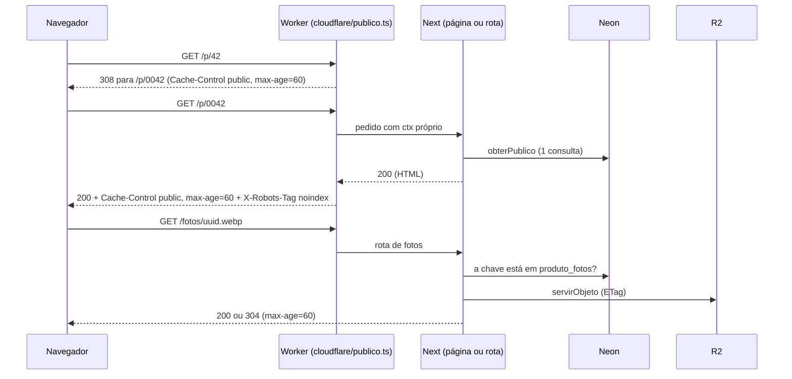

# F05 — Catálogo público

> Estado: **construída (SF1 a SF12, ramo FALLBACK), já em `main` (commits da 005 no histórico;
> deploy de produção não verificado aqui).** Spec: [`specs/005-catalogo-publico/spec.md`](../../specs/005-catalogo-publico/spec.md);
> decisão de cache: [ADR-011](../../specs/adr/011-cache-catalogo-workers-dev.md);
> critérios de sucesso: [`rastreabilidade.md`](../../specs/005-catalogo-publico/rastreabilidade.md).

## Visão leiga

É a vitrine da loja, aberta a qualquer pessoa, **sem login**. Quem recebe o link abre a página
inicial e vê, nesta ordem: os produtos em destaque (as vagas que as administradoras escolhem no
painel), um filtro por categoria e a lista de produtos, do mais recente ao mais antigo. A lista
mostra 24 por vez, com o botão "Carregar mais". Tocar num produto abre o detalhe (`/p/0042`):
fotos, preço, descrição e o botão "Perguntar no WhatsApp", que abre uma conversa com a loja já
com o nome do produto, o código e o link. Produto esgotado aparece com a marca "Esgotado" e sem
o botão.

Não há conta, busca nem pagamento; a sacola é a [F06](./F06-sacola-whatsapp.md). O catálogo **não aparece em buscadores** de
propósito (`noindex`): o endereço circula por link direto. Se o banco estiver fora do ar, a
pessoa vê "Não foi possível carregar agora" com o botão "Tentar de novo", nunca um "produto não
encontrado" falso. O que a administradora muda no painel (preço, esgotado, foto, remoção)
aparece aqui em até 1 minuto.

## Aprofundamento técnico

### Rotas

| Rota | Handler | O que faz |
|---|---|---|
| `GET /` | `src/app/(public)/page.tsx` | Lê `?categoria=<slug>` no servidor (`lerVitrine`) e renderiza destaques, filtro e o 1º bloco da lista. Slug desconhecido ou de categoria sem produtos vira "Todas". `force-dynamic`. |
| `GET /p/[codigo]` | `src/app/(public)/p/[codigo]/page.tsx` | Detalhe do produto (`lerProduto`). Código fora do canônico redireciona (`permanentRedirect`, 308); inexistente ou produto removido dá `notFound()` (404 "Produto não encontrado", `p/[codigo]/not-found.tsx`). `generateMetadata` define título e a capa como imagem de prévia (Open Graph); sem `SITE_URL` válida, sem imagem. |
| `GET /api/catalogo/produtos?depois=<cursor>&categoria=<slug>` | `src/app/api/catalogo/produtos/route.ts` | Só o "Carregar mais": devolve `{ itens, proximo, categoria }`. Cursor inválido: 400 `{}`; banco fora: 503 `{}` `no-store`. `Cache-Control: public, max-age=20`. |
| `GET /fotos/[arquivo]` | `src/app/fotos/[arquivo]/route.ts` | Foto pública. Valida o formato do nome, confere no banco se a chave está em `produto_fotos` (`lerFoto`) e serve o objeto do R2 com `ETag`/304. Toda recusa (malformada, inexistente, envio pendente, foto removida) é o **mesmo 404 vazio**, com os mesmos cabeçalhos. Exceção em qualquer passo: 503 vazio `no-store`. `max-age=60`. |
| `GET /robots.txt` | `src/app/robots.ts` | `Allow: /`, sem `Disallow` e sem sitemap: um `Disallow` impediria o buscador de ler o `noindex` (research D9). |

Páginas de erro: `src/app/(public)/error.tsx` (client; "Tentar de novo" faz `router.refresh()` +
`reset()`). Os contratos de cache, status e `X-Robots-Tag` estão em
[architecture.md](../architecture.md#catálogo-público-feature-005).

### Arquivos

| Arquivo | Papel |
|---|---|
| `src/lib/catalogo/index.ts` | Barrel `server-only`, **única porta** de páginas e rotas (regra do ESLint em `eslint.config.mjs`; exceções: `exibicao`, `prazos` e `restauracao`, que são puros). |
| `src/lib/catalogo/leitura.ts` | `lerVitrine`, `lerBloco`, `lerProduto`, `lerFoto`: único lugar que chama `dbDoContexto`. Monta as visões públicas (sem id de categoria, versões, vaga de destaque nem auditoria). Falha de banco marca a causa (`marcarCausaBanco`) e relança; nunca vira "não encontrado". |
| `src/lib/db/catalogo.ts` | SQL público: `listarDestaques`, `listarBloco` (24 + 1 para saber se há mais), `categoriasComProdutos`, `obterPublico`, `fotoPublica`. Só lê `categorias`, `produtos`, `produto_fotos`; nunca `fotos_envio`. Um statement por função (ADR-008). |
| `src/lib/catalogo/config.ts` | `configCatalogo()`: `WHATSAPP_NUMBER` (E.164) e `SITE_URL`. Valor inválido não derruba a página: o campo vira `null` e a falha é registrada **uma vez por isolate**. |
| `src/lib/catalogo/exibicao.ts` | Regras puras: `precoPublico`, código canônico (4 dígitos), `mensagemWhatsapp`, `linkWhatsapp` (`wa.me`), `mostrarWhatsapp`, `acrescentarSemRepetir`. Usado também por componentes cliente. |
| `src/lib/catalogo/cursor.ts`, `slug.ts` | Cursor opaco (base64url de `<µs>.<id>`, microssegundos sempre como texto) e validação do slug. |
| `src/lib/catalogo/restauracao.ts` | Restauração da lista ao voltar do detalhe (ver abaixo). Puro, sem `server-only`. |
| `src/lib/catalogo/falha.ts`, `registro.ts` | Registro estruturado de falhas (listas fechadas de evento, rota e causa). `falha.ts` é puro para o worker importá-lo; `registro.ts` marca a causa no `ctx` do pedido. |
| `src/lib/catalogo/prazos.ts` | `NAVEGADOR_PAGINA_S` 60, `NAVEGADOR_LISTA_S` 20, `NAVEGADOR_FOTOS_S` 60. |
| `cloudflare/publico.ts` | Casca do worker para as rotas públicas: canoniza `/p/<x>`, aplica `Cache-Control`/`X-Robots-Tag` e converte 500 em 503. |
| `src/app/(public)/_catalogo/` | Componentes: `cartao-produto`, `destaques`, `filtro` (links, sem JS), `lista-catalogo` (client: "Carregar mais" e restauração), `link-catalogo` (client), `galeria`, `botao-whatsapp`, `textos.ts` (todos os textos). |
| `scripts/seed-catalogo-local.ts` e `scripts/seed-catalogo-local/` | Seed de teste (ver abaixo). |

### Fluxo

Se `obterPublico` (ou qualquer consulta) falhar, `leitura.ts` marca `causa = "banco"` no `ctx`, a
página responde 500 e o worker troca por **503** com `Cache-Control: no-store` e `Retry-After: 30`,
registrando `catalogo.banco_indisponivel`.

### Restauração da lista ao voltar

Ao tocar num produto, `ListaCatalogo` (clique simples, sem Ctrl/Meta/Shift) grava no
`sessionStorage` da aba, chave `catalogo:<slug|todas>`: os itens já carregados, o cursor, o
`scrollY` e o caminho do item aberto, com validade de 30 minutos. No detalhe, o link "Voltar ao
catálogo" (`LinkCatalogo voltar`) só usa `router.back()` se houver restauração válida **para
aquele item**; assim volta a lista com os mesmos blocos, filtro e posição. A restauração é lida
uma vez (e apagada) na remontagem da lista. "Ver o catálogo" por qualquer outro caminho chama
`limparRestauracoes()` e começa do 1º bloco. A URL **nunca** ganha parâmetro de bloco. Sem
`sessionStorage` (modo privado, cota cheia) tudo falha em silêncio e a lista volta do início.

### Seed de teste (catálogo de exemplo)

Sem produtos reais, o catálogo fica vazio. Dois modos, ambos com **trava por igualdade exata**
(`scripts/seed-catalogo-local/trava.ts`) e que só apagam o que eles mesmos criaram (autor
`seed@local` ou `seed@dev`):

| Comando | Alvo | Pré-requisitos |
|---|---|---|
| `npm run seed:local` | Postgres do Docker + bucket local do wrangler | `db:up`, `db:migrate` e `npm run preview` no ar |
| `npm run seed:dev` | Branch dev do Neon + bucket `roseshop-dev` | `.seed-dev.vars` (cópia do `.seed-dev.vars.example`, só `DATABASE_URL` direta) e `npx wrangler login`; as fotos vão por `wrangler r2 object put --remote` |
| `npm run seed:dev:limpar` | idem | remove só o que o seed criou |

Produção e o pooler do Neon são recusados pela trava. Roda com o Node nativo (`node
--env-file...`), por isso os imports do script são relativos, com extensão.

### Pegadinhas

- **Sem cache no servidor.** Em `*.workers.dev` não há cache de borda; o ISR foi reprovado no
  spike (ADR-011). Toda visita a `/` e `/p/*` renderiza e consulta o Neon. O único cache é o do
  navegador (`max-age=60`), e o 404 também fica 60 s: um produto recém-cadastrado pode demorar
  até 60 s para aparecer a quem já abriu o link.
- **`/p/<código>` aceita lixo.** O worker reescreve código inválido (não numérico, zero, mais de
  9 dígitos) para `/p/0`, caminho fixo que o Next responde 404, sem consultar o banco. Códigos
  numéricos válidos mas inexistentes consultam o Neon (varredura: risco aceito R3; ver
  [operacao.md](../operacao.md#catálogo-público-sinais-e-contingências)).
- **`next dev` não passa pelo worker.** O `cloudflare/publico.ts` (308 de canonização,
  `Cache-Control`, `X-Robots-Tag`, 503) só existe no `preview` e no dev online. Valide o
  comportamento de rotas públicas no `preview`.
- **`wrangler dev` escreve `console.error` no stderr**; para guardar os registros do catálogo,
  `npm run preview > arquivo.log 2>&1`. Ao encerrar, o wrangler repete o stderr, e um evento
  parece duplicado (o worker registra uma vez por pedido).
- **Fotos por `` simples**, com `width`/`height` fixos e `loading` (destaques, os 4 primeiros
  cartões da lista e a 1ª foto do detalhe são `eager`); sem otimização de imagem do Next.
- **Prévia do WhatsApp** depende de `SITE_URL` válida no ambiente (sem barra final; `https`, ou
  `http` só em localhost): sem ela a mensagem sai sem link e a página sem imagem de prévia.
- **CPU acima de 10 ms** do Workers Free em `/` e no detalhe: risco aceito (T139), ver
  [operacao.md](../operacao.md#limite-de-cpu-do-plano-gratuito-do-workers).
- **Acessibilidade verificada em teste** com `axe-core` (`src/test/axe.ts`) nos componentes e
  páginas do catálogo, dentro do `npm run check`.
