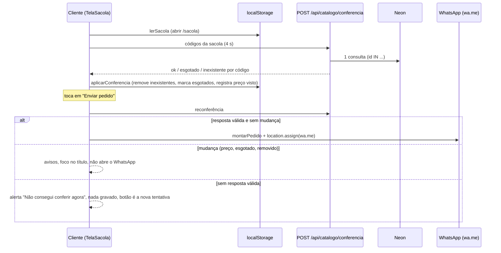

# F06 — Sacola e envio pelo WhatsApp

> Estado: **construída (SF1 a SF9), pronta para o merge, ainda não em produção.** Spec:
> [`specs/006-sacola-whatsapp/spec.md`](../../specs/006-sacola-whatsapp/spec.md); decisões:
> [ADR-012](../../specs/adr/012-conferencia-sacola.md) (conferência por POST) e
> [ADR-013](../../specs/adr/013-desvio-constitution-iv.md) (regras da sacola no cliente);
> contratos em `specs/006-sacola-whatsapp/contracts/` e provas em
> [`rastreabilidade.md`](../../specs/006-sacola-whatsapp/rastreabilidade.md).

## Visão leiga

É o "carrinho" da loja, sem conta e sem pagamento. No detalhe de um produto disponível, a
cliente toca em "Adicionar à sacola"; no canto da página aparece "Sacola, 2 produtos". Em
`/sacola` ela ajusta a quantidade (1 a 10 por produto, até 15 produtos), remove itens, escreve
uma observação de até 200 caracteres e toca em "Enviar pedido pelo WhatsApp": o WhatsApp abre
com a mensagem pronta (quantidades, nomes, códigos, preços, subtotal e observação), endereçada
à loja. A loja confirma o pedido na conversa.

A sacola **mora só no aparelho** (`localStorage`, validade de 7 dias). O servidor não guarda
pedido nenhum. Antes de mostrar a sacola e de novo antes de enviar, o site confere cada produto
com o catálogo atual: produto removido ou esgotado é avisado e não entra no pedido; preço que
mudou barra o envio até a cliente ver o valor novo. Se a conferência falhar (sem rede, mais de 4
s, erro do servidor), o WhatsApp **não abre**: nunca se envia pedido com dados não conferidos.
Sem JavaScript ou sem `localStorage`, a sacola não aparece e a cliente ainda pode perguntar por
produto no WhatsApp (F05).

## Aprofundamento técnico

### Rotas

| Rota | Handler | O que faz |
|---|---|---|
| `GET /sacola` | `src/app/(public)/sacola/page.tsx` | Casca `force-dynamic` (`noscript` com aviso e link ao catálogo) + `TelaSacola` com o `WHATSAPP_NUMBER` já validado (`configCatalogo().whatsapp`, `null` se inválido). Não lê sacola nenhuma: ela só existe no navegador. |
| `POST /api/catalogo/conferencia` | `src/app/api/catalogo/conferencia/route.ts` | Corpo `{"codigos":["0042",...]}` (1 a 15 códigos canônicos, sem repetição, sem chave extra). Devolve `{itens}` com um item por código, **na ordem pedida**: `ok`, `esgotado` (dados públicos + preço em centavos) ou `inexistente`. Público, sem sessão, `no-store`, `nosniff`. |

Erros da conferência (corpo `{}`, ordem de checagem): 415 (`Content-Type` não é `application/json`)
→ 413 (`Content-Length` > 1024, corpo nem é lido) → 413 (leitura em stream passou de 1024 bytes)
→ 400 (JSON inválido ou fora do esquema; inclui `"0000"` e código acima de 2147483647) → 503
(banco indisponível) / 500 (qualquer outro erro). Outros métodos recebem o 405 padrão do Next
(só `POST` é exportado; esse 405 não leva `no-store` nem `nosniff`, por emenda do contrato).

### Arquivos

| Arquivo | Papel |
|---|---|
| `src/lib/sacola/observacao.ts` | Única regra da observação: `normalizarObservacao`, `contarCaracteres` (code points), `OBSERVACAO_MAX` 200. |
| `src/lib/sacola/sacola.ts` | Tipos e operações puras sobre a sacola relida: `adicionar`, `mudarQuantidade`, `remover`, `limpar`, `aplicarConferencia`; limites (`MAX_PRODUTOS` 15, quantidade 1 a 10, `VALIDADE_MS` 7 dias). |
| `src/lib/sacola/total.ts` | Valor da linha e subtotal em centavos inteiros ("R$ 12,00", "a partir de …", "Consulte o valor"). |
| `src/lib/sacola/mensagem.ts` | `montarPedido` (texto + URL `wa.me`, `ORCAMENTO_URL` 1800 caracteres codificados; só os nomes encolhem, até `NOME_MAX` 40), `restanteObservacao`, `medidorObservacao`. |
| `src/lib/sacola/conferencia.ts` | Cliente da rota: `conferir` (POST, 4 s, nunca lança, devolve `"falha"`), validação da resposta com `zod/mini`, `juntar`, `houveMudanca`. |
| `src/lib/sacola/armazenamento.ts` | `localStorage` (chave `roseshop.sacola`): `lerSacola` nunca grava; `alterarSacola` relê, aplica a operação, grava e dispara o evento local `roseshop:sacola`; `assinarSacola` escuta o evento e `storage` (outra aba). Todo acesso em `try/catch`. |
| `src/lib/sacola/textos.ts` | Todos os textos das telas e da mensagem. |
| `src/lib/db/catalogo.ts` | `conferirProdutos`: um único `SELECT ... WHERE id IN (...)` (mesma capa da F05), sem `ORDER BY`. |
| `src/lib/catalogo/leitura.ts` | `lerConferencia` (monta os três estados, lança `BancoIndisponivel` se o banco falhar); `lerProduto` passou a devolver `sacola` (dados do botão, `null` se esgotado). Exportados pelo barrel `src/lib/catalogo/index.ts`. |
| `src/app/(public)/_sacola/` | Ilhas cliente: `acesso-sacola` (contador no cabeçalho), `botao-sacola` (detalhe), `tela-sacola`, `item-sacola`, `observacao`, `enviar-pedido`, `confirmar-limpar` (`<dialog>`), `usar-sacola` (`useSyncExternalStore`), `navegar` (`window.location.assign`, separado para teste). |
| `src/app/(public)/layout.tsx` e `p/[codigo]/page.tsx` | Únicos acréscimos ao HTML da F05: `
` (altura fixa) e `
`, vazios no servidor. O teste da SC-005 remove `[data-sacola]` e compara com os fixtures da 005. |
| `cloudflare/publico.ts` | `/sacola` entra como página pública (`noindex`, `max-age=60`, 500 vira 503). `POST /api/catalogo/conferencia` passa **sem alteração** (a rota é dona dos cabeçalhos). Ver [architecture.md](../architecture.md#sacola-e-conferência-feature-006). |

### Fluxo do envio

Depois que o WhatsApp abre, ao voltar a tela mostra a confirmação ("Seu pedido foi aberto no
WhatsApp"), marcada em `history.state.sacolaEnviada`, com "Limpar sacola" e "Voltar". A sacola
**não é limpa sozinha**.

### Desvio da constitution IV (ADR-013)

A constitution IV pede "nenhuma lógica de negócio no client". Como a sacola é só do aparelho e
nada do pedido pode ir ao servidor, as regras rodam no navegador, **restritas a `src/lib/sacola/`
e às ilhas de `_sacola/`**. O que vale (preço, disponibilidade, existência) vem sempre da
conferência; o preço guardado serve só para avisar mudança e nunca entra no subtotal nem na
mensagem. A fronteira do módulo é travada em duas camadas:

- `src/lib/sacola/fronteira.test.ts`;
- regras de lint em `eslint.config.mjs`: o módulo só importa `@/lib/produtos/preco`,
  `@/lib/catalogo/exibicao`, `zod/mini` e os próprios arquivos (sem `server-only`, `next/*`,
  banco, auth, R2 nem o barrel `@/lib/catalogo`).

### Pegadinhas

- **`next dev` não passa pelo worker.** `/sacola` só ganha `X-Robots-Tag` e `Cache-Control` no
  `preview` e no dev online (`cloudflare/publico.ts`). A conferência por `POST` é igual nos dois.
- **Logs sem pedido.** A rota registra só `catalogo.banco_indisponivel` (503) ou
  `catalogo.erro_inesperado` (500, com o **nome da classe** do erro). Nunca corpo, códigos,
  mensagem de exceção nem `Content-Length`. Teste de conformidade
  (`src/test/conformance/conferencia-acesso.test.ts`) espiona o `console`.
- **Observação sem `maxLength`.** O limite real é o menor entre 200 code points e o espaço que a
  URL do `wa.me` deixa; entrada que estouraria é desfeita, excesso causado por a sacola crescer
  é mostrado e bloqueia o envio.
- **Duas abas.** Cada alteração relê o `localStorage` antes de aplicar (FR-008a), sem
  `navigator.locks` (risco R1 aceito); mudança vinda de outra aba só re-renderiza e anuncia o
  contador.
- **Abre o WhatsApp na mesma aba** (`window.location.assign`): `window.open` depois de um
  `await` é barrado pelo bloqueador de pop-up.
- **Sem cache nem limite de taxa na conferência**: cada abertura e cada envio custam um pedido
  ao Worker e uma consulta ao Neon; varredura limitada a 15 códigos por pedido (ADR-012). Sinais
  em [operacao.md](../operacao.md#sacola-sinais-e-pendências-de-entrega).
- **Pendências de entrega** (não bloqueiam o merge): número da Rose no `WHATSAPP_NUMBER` de
  produção (hoje é o de teste do mantenedor), SC-001 com cliente real e a trava do `seed:dev`
  com `sslmode=verify-full` (ver operacao.md).
