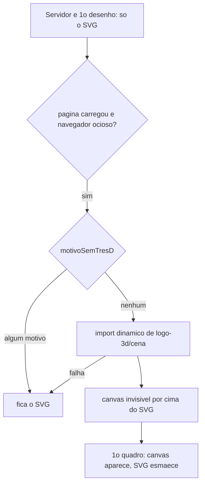

# Identidade visual "Janela" (ADR-005)

> Estado: **construída na branch `experimento/design-ia`** (13 commits à frente de `main`; ainda não
> integrada em `main`, nem provada em produção: a confirmar pelo tech-lead). Decisão:
> [`specs/adr/005-componentes-ui-e-identidade.md`](../specs/adr/005-componentes-ui-e-identidade.md)
> (aceito em 2026-10-16). Não há migration, variável de ambiente nem binding novos.

## Visão leiga

É a "cara" da loja: cores (rosa, creme e um céu azulado), duas fontes (uma com serifa para títulos
e preços, outra de leitura fácil para o texto) e um símbolo de três arcos que lembra uma janela. O
catálogo público, a sacola e o painel passaram a usar o mesmo conjunto de cores e botões. No
topo da página inicial, em aparelhos capazes, o símbolo vira um pequeno objeto 3D que gira
devagar; em qualquer outro caso (celular modesto, economia de dados, movimento reduzido) fica o
mesmo símbolo parado, em SVG. Nenhum fluxo mudou: as telas só ficaram diferentes.

## Aprofundamento técnico

### O que o ADR-005 decide

| Tema | Decisão |
|---|---|
| Componentes | Sem biblioteca em runtime: primitivos próprios em `src/components/ui/` sobre elementos nativos (`<button>`, `<input>`, `<select>`, `<textarea>`, `<dialog>`, `<progress>`). shadcn e 21st só como referência de acessibilidade; nada deles é instalado. |
| Rolagem lateral | Destaques e galeria do detalhe usam `scroll-snap` do CSS (último cartão cortado na borda como indício de continuação; cartões focáveis; sem rolagem horizontal da página; grade no desktop). Única lógica cliente: `IntersectionObserver` nos pontos da galeria. |
| Movimento | Sem o pacote `motion`: molas em CSS `linear()` (`--mola`, `--mola-duracao` em `src/app/globals.css`), `@keyframes` e View Transitions onde houver suporte; tudo some com `prefers-reduced-motion: reduce`. |
| Tema | Só claro (`color-scheme: light`). |
| Fontes | Hospedadas em `public/fonts/`, sem chamada externa; sai o `next/font/google` (Geist). |
| `design/` | Fora do app: `@source not "../../design"` no `globals.css`, `design` no `exclude` do `tsconfig.json`, `design/**` nos `ignores` do `eslint.config.mjs`, fotos de terceiros de `design/direcoes/_fotos/*` fora do git (só `CREDITOS.md`). |
| Logo 3D | `three` puro, em ilha cliente carregada por `import()` dinâmico. Recusado o `@react-three/fiber` (10 dependências transitivas). |

### Tokens

Definidos em `src/app/globals.css`: variáveis `--cor-*` no `:root` e mapeadas no `@theme inline`
do Tailwind v4 como `--color-*`. Nomes pelo papel: `superficie`, `superficie-2`, `texto`,
`texto-suave`, `acao`, `acao-forte`, `ceu`, `luz`, `sucesso`, `sucesso-fundo`, `erro`,
`erro-fundo`, `linha`, `foco` (= `acao`). Fontes: `--font-texto` e `--font-titulo`, cada uma com
fallbacks de métrica ajustada (`size-adjust`, `ascent-override`...) para evitar salto de layout.
Valores e contrastes (AA) estão em `design/DIRECOES.md`; a escolha da direção "Janela" entre três
candidatas em `design/IMERSAO.md`, `design/DIRECOES.md` e `design/REFERENCIAS.md`.

### Fontes locais (`public/fonts/`)

| Arquivo | Família | Uso |
|---|---|---|
| `YoungSerif-Regular.woff2` | Young Serif | Títulos e preços |
| `AtkinsonHyperlegibleNext-Regular.woff2`, `AtkinsonHyperlegibleNext-Bold.woff2` | Atkinson Hyperlegible Next | Texto |
| `YoungSerif-OFL.txt`, `AtkinsonHyperlegibleNext-OFL.txt` | Licença OFL 1.1 de cada família | Texto da licença junto dos arquivos |

Carregamento: `@font-face` em `src/app/globals.css` (`font-display` e métricas de fallback);
`src/app/layout.tsx` faz `preload` **só** da Atkinson Regular (a Young Serif, 80 KB, não disputa banda
com a foto do LCP). `public/_headers` dá `Cache-Control: public,max-age=31536000,immutable` a
`/fonts/*`: **trocar a fonte exige trocar o nome do arquivo**, senão o cache de 1 ano a esconde.

### Componentes

| Onde | Componente | Papel |
|---|---|---|
| `src/components/ui/logo.tsx` | `LogoMarca` | Símbolo SVG (três arcos sobre um parapeito, `currentColor`). Sem `<title>`/`<text>`: a `/sacola` sem JavaScript não pode ter texto de servidor. |
| `src/app/(public)/_catalogo/topo.tsx` | `Topo` | Cabeçalho das páginas internas (detalhe, sacola, não encontrado); o símbolo leva à loja. |
| `.../_catalogo/link-inicio.tsx` | `LinkInicio` | Link cliente do símbolo; limpa as restaurações da lista. Sem `useRouter`. |
| `.../_catalogo/logo-janela.tsx` | `LogoJanela` | Logo da página inicial: SVG no servidor; canvas 3D entra por cima depois. |
| `.../_catalogo/logo-3d/cena.ts` | `montarCena` | Única importadora do `three` (geometria em código, sem arquivo de modelo). |
| `.../_catalogo/logo-3d/condicoes.ts` | `motivoSemTresD`, `lerAmbiente` | Quando o 3D não carrega (ver abaixo); puro e testável. |
| `.../_catalogo/pontos-galeria.tsx` | `PontosGaleria` | Pontos da galeria do detalhe (`aria-hidden`, só após hidratar). |

Também foram reestilizados, sem mudar contrato: os primitivos de `src/components/ui/` (`button`,
`campo-texto`, `area-texto`, `selecao`, `caixa-marcacao`, `mensagem-campo`, `aviso`), os
componentes de `_catalogo/` e `_sacola/`, as páginas do painel e `not-found`/`error` do catálogo.

### Logo 3D: quando carrega

Motivos para ficar no SVG (`condicoes.ts`): movimento reduzido, economia de dados, menos de 5
núcleos (ou desconhecido), memória informada abaixo de 3 GB, sem WebGL. O 3D pausa fora da tela
(`IntersectionObserver`) e com a aba oculta (`visibilitychange`), e volta ao SVG se a pessoa pedir
menos movimento no meio do caminho. Só a página inicial (`src/app/(public)/page.tsx`) usa
`LogoJanela`.

O teste `src/test/conformance/three-so-no-logo.test.ts` trava: só `logo-3d/cena.ts` importa
`three`; a cena não usa `examples`/`addons`/loaders; ninguém mais a importa estaticamente (só
`import()` dinâmico ou `import type`).

### Dependências novas

| Pacote | Versão | Tipo |
|---|---|---|
| `three` | `0.186.1` (exata) | runtime, só no chunk lazy do logo |
| `@types/three` | `0.186.0` (exata) | dev |

Instaladas com `--ignore-scripts`; auditoria e dependências de apoio dos tipos em
[ADR-005](../specs/adr/005-componentes-ui-e-identidade.md). Medido por `design/CPU.md`: chunk do
three com 131,2 KB gzip (532,3 KB sem compressão), fora do JS inicial (197,9 KB gzip).

### Scripts de validação (`design/validacao/`)

Não são scripts npm: rodam à mão, contra o `preview` no ar, e ficam fora de lint, `tsc` e Tailwind.

| Arquivo | O que faz | Como roda |
|---|---|---|
| `medir-logo-3d.mjs` | Mede LCP, CLS e CPU do logo (SVG × 3D) num Chrome com WebGL por software, 360 px, CPU 4x mais lenta; salva capturas. | `node design/validacao/medir-logo-3d.mjs <pasta-de-saida> [url]` |
| `three-fora-do-inicial.mjs` | Confere que o `three` não está no JS inicial da `/` e mede o chunk (lê `.open-next/assets`). | `node design/validacao/three-fora-do-inicial.mjs http://localhost:8787/` |
| `html-005.diff.test.tsx` + `vitest.html-005.config.mts` | Gera o HTML do servidor que os fixtures da 005 cobririam, para comparar sem regravá-los. | `HTML_005_SAIDA=<pasta> npx vitest run --config design/validacao/vitest.html-005.config.mts` |
| `rolar-tudo.js` | Rola a página para carregar fotos `lazy` antes da captura (usado via `evaluate_script` do chrome-devtools). | colado no MCP, sem CLI |
| `medicao-logo-3d-fase7.json` | Resultado salvo da medição da Fase 7. | dado |

Relatórios em `design/`: `VALIDACAO.md`, `CPU.md`, `AUTOAVALIACAO.md`, `SUGESTOES.md`.

### Desempenho do LCP na página inicial

Commit `1cd8aa2`: em `_catalogo/destaques.tsx`, só os 2 primeiros destaques são `eager` (o primeiro
com `fetchpriority="high"`); o resto dos destaques e toda a lista são `lazy` (antes eram 9 fotos
eager). Relato em `design/VALIDACAO.md`: LCP de `/` em Slow 4G de 8,3 s para cerca de 6,6 s, ainda
acima da meta de 2,5 s (a foto de ~230 KB é o limite; miniatura é só sugestão em `design/SUGESTOES.md`).
Isso muda a regra numérica de eager da FR-008 da 005 (ver [F05](./features/F05-catalogo-publico.md));
o fixture `src/test/fixtures/catalogo/inicio-005.html` foi regravado (commit `1bee30e`).

### Pegadinhas

- Fixtures HTML da 005 (`src/test/fixtures/catalogo/*.html`) foram regravados em 3 commits; o layout
  só pode acrescentar o espaço da sacola ao HTML (SC-005 da 005). Mudou markup? Reveja os fixtures.
- O `three` só pode ser importado por `logo-3d/cena.ts`; importá-lo noutro lugar quebra o teste de
  conformidade e põe ~130 KB gzip no JS inicial.
- Fonte nova ou trocada: renomear o arquivo (cache `immutable` de 1 ano).
- Custo do 3D medido em SwiftShader (CPU), pessimista para celular com GPU; não há medição em
  aparelho real (a confirmar pelo tech-lead).
